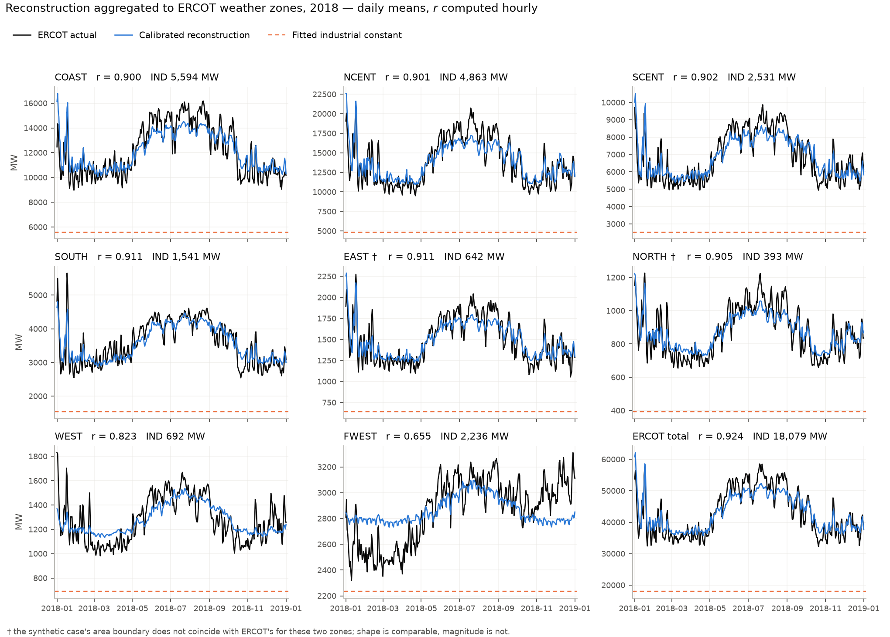

# Bus-Level Load Reconstruction for Synthetic Power Grids — Statewide Texas

Reconstructs hourly electricity load at every bus of the Texas 7k synthetic grid from weather
data, NREL building-stock simulations and U.S. Census data, and validates the result against
ERCOT's published 2018 load.

This extends the framework of Kang, Baembitov, Safdarian, Snodgrass and Overbye from the original
ERCOT Coast case study (200 buses, one climate zone) to the entire state: 6,717 buses, five IECC
climate zones, residential and commercial sectors, validated against all eight ERCOT weather
zones.



## Results

| Metric | Reconstruction | ERCOT actual |
| --- | ---: | ---: |
| Statewide peak | 72,617 MW | 73,308 MW |
| Load factor | 0.592 | 0.586 |
| Pearson correlation | 0.922 | — |
| Mean absolute error | 2,963 MW | — |

Fitted industrial load is 18,079 MW, or 24.7 percent of system peak. Per-zone results, the full
metric suite and all figures are in the reports below.

## Documentation

| Document | Length | Contents |
| --- | --- | --- |
| [`latex_report/statewide_results_summary.pdf`](latex_report/statewide_results_summary.pdf) | 9 pp. | Method, results and figures. Written as the basis for the paper. |
| [`latex_report/report.pdf`](latex_report/report.pdf) | 33 pp. | Complete record: defects found and corrected, every intermediate pipeline version, full audit. |
| [`CLAUDE.md`](CLAUDE.md) | — | Project context and reproduction targets. |

## Requirements

Python 3.11. Dependencies are pinned in `pyproject.toml` and `uv.lock`.

```bash
uv sync
```

A U.S. Census API key is required for the B25024 housing-unit query. Provide it either as the
environment variable `CENSUS_API_KEY` or in a file `census_api_key.txt` at the repository root.
That file is excluded from version control.

The first run downloads approximately 5 GB of NREL ResStock and ComStock archetype profiles and
AMY weather files. Subsequent runs use the local cache.

## Usage

The pipeline is a sequence of notebooks in `statewide/notebooks/`. Run them in the following
order.

| Step | Notebook | Output |
| --- | --- | --- |
| 1 | `00_zone_mapping` | Mapping tables used by every later step |
| 2 | `residential_{2A,2B,3A,3B,4B}` | Bus-level residential profiles, 5 ResStock archetypes |
| 3 | `commercial_{2A,2B,3A,3B,4B}` | Bus-level commercial profiles, 15 ComStock archetypes |
| 4 | `zone_calibration` | Per-zone scale factors and fitted industrial constant |
| 5 | `ercot_zone_validation` | Validation against the eight ERCOT weather zones |
| 6 | `validation_metrics_statewide` | Load duration curve, diurnal shape, monthly bias, coincidence factor |
| 7 | `statewide_summary` | Cross-zone comparison and cross-check against the Coast pipeline |

Steps 2 and 3 are mutually independent and may run in either order. Step 1 is the only step that
requires the large input files described below.

To rebuild the reports:

```bash
cd latex_report
tectonic report.tex
tectonic statewide_results_summary.tex
```

## Repository structure

| Path | Contents |
| --- | --- |
| `statewide/notebooks/` | The pipeline described above |
| `statewide/*.csv` | Mapping tables produced by step 1: bus-to-zone, tract-to-bus weights, ZCTA-to-bus weights, archetype counts per bus |
| `statewide/metrics/` | Every figure in the reports, as source CSV |
| `latex_report/` | Both reports, their LaTeX sources and `figures/` |
| `*.ipynb` (root) | Original Coast-only study and the methodology notebooks documented in `report.pdf`. Superseded by the statewide pipeline; retained for provenance. |
| `metrics*/` (root) | Metrics from the Coast study |

Trained models, the 8760 × N bus profile files (approximately 1.9 GB), NREL downloads, TIGER/Line
shapefiles and the ArcGIS project are excluded from version control because the notebooks rebuild
them. See `.gitignore`.

## Required input data

The following files are manual exports and cannot be regenerated from code.

| File | Contents |
| --- | --- |
| `texas7k_bus_with_climate_zone.csv` | 6,717 buses: coordinates, nominal kV, case `Load_MW` and `Gen_MW`, county FIPS, IECC zone, ERCOT `Area_Name` |
| `loadcurves/exports/Native_Load_2018.xlsx` | ERCOT actual load by weather zone, 2018 |
| `loadcurves/exports/tract_to_bus_mapping.csv` | Coast-only tract-to-bus assignment |
| `loadcurves/exports/zcta_bus_mapping_tx_final.csv` | Statewide ZCTA to nearest bus |
| `loadcurves/exports/tl_2018_48_puma10_COAST.csv` | Coast PUMA attribute table |
| `loadcurves/exports/tl_2018_us_zcta510_COAST_centwithin.csv` | Coast ZCTA attribute table |

Two further exports exceed GitHub's 100 MB file limit and are therefore not included in this
repository.

| File | Size | Contents |
| --- | ---: | --- |
| `tract_to_bus_mapping_statewide1.csv` | 118 MB | Each 2020 census tract subdivided into 50 equal-area parts, each part joined to its nearest bus |
| `zcta_to_bus_mapping_statewide_tracts_subdivided100.csv` | 53 MB | The same for 2010 ZCTAs, 100 parts each |

Their information is committed in aggregated form as `statewide/tract_bus_weights.csv` and
`statewide/zcta_bus_weights.csv`, where `weight = parts won / total parts`. Every step after the
first reads the aggregated tables, so the raw exports are needed only to re-run step 1. Keep them
backed up outside version control and place them at the repository root when required.

## Implementation notes

**Target column names differ between datasets.** ResStock uses
`out.electricity.total.energy_consumption..kwh` with two dots; ComStock uses
`...energy_consumption.kwh` with one. They are not interchangeable.

**Time zone handling.** ResStock and ComStock profiles are in fixed EST without daylight saving.
ERCOT load is in Central time with daylight saving, uses `24:00` hour endings, and marks the
duplicated autumn hour with a `DST` suffix. The parsing cell resolves this with an `ambiguous`
mask and a conversion to `Etc/GMT+5`.

**Census tract vintage.** The statewide mapping uses 2020 tract boundaries and requires the
2020-vintage B25024 extract; the Coast files use 2010 boundaries. Combining the two silently
drops roughly 40 percent of buses.

**ERCOT EAST and NORTH zones.** The synthetic case's area boundaries do not coincide with ERCOT's
for these two zones; case peak load is 1.33 and 2.21 times the corresponding ERCOT zonal peak.
Their shape statistics remain comparable, their magnitudes do not.

## Limitations

Industrial load is represented by a fitted constant rather than a model, so it cannot reproduce
the temporal variation of industrial demand. This bounds ERCOT FAR WEST at a correlation of
0.655, where the fitted constant accounts for 61 percent of zonal peak.

ERCOT South Central fits a null commercial scale factor. Insufficient bus coverage and
collinearity were both tested and ruled out as explanations; the result is unexplained.

All buses within a climate zone share a single blended weather series, which is why within-zone
coincidence factors remain close to unity while the statewide value falls to 0.941.

The complete list, with target values, is in section 6 of
[`statewide_results_summary.pdf`](latex_report/statewide_results_summary.pdf).
